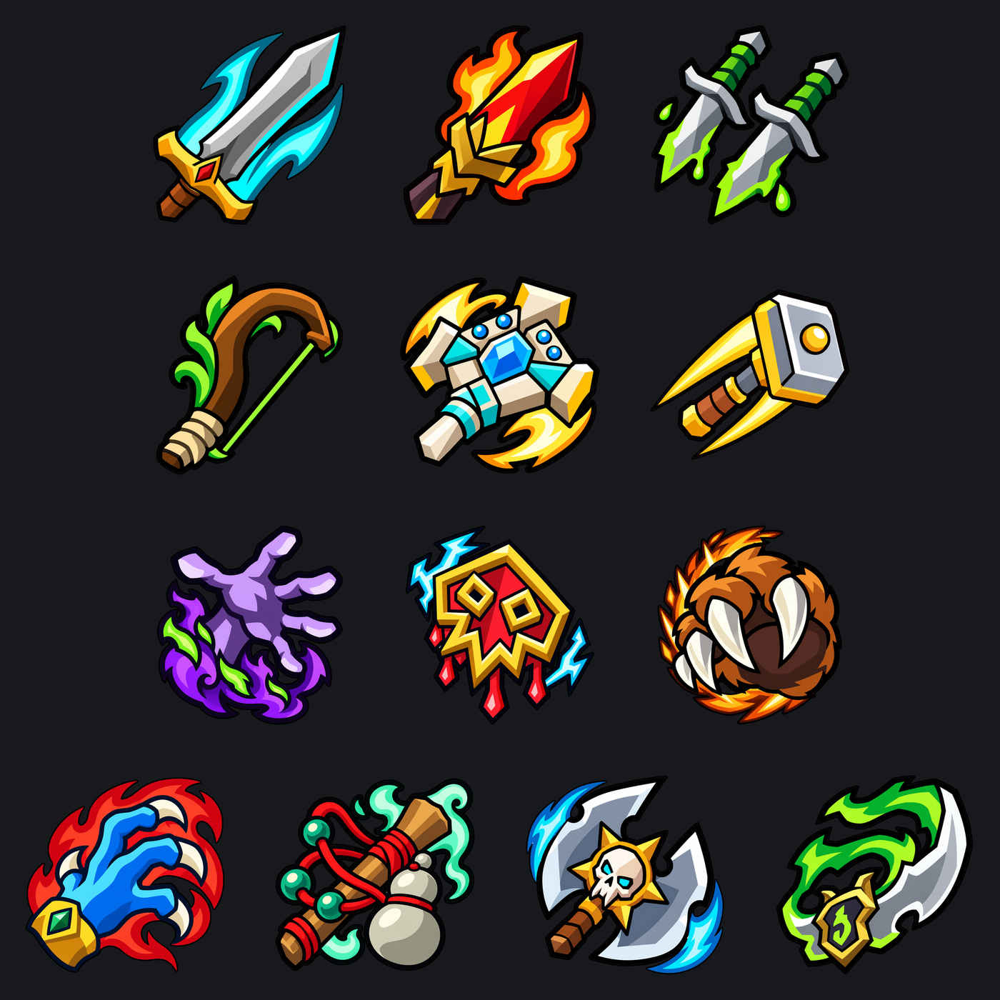
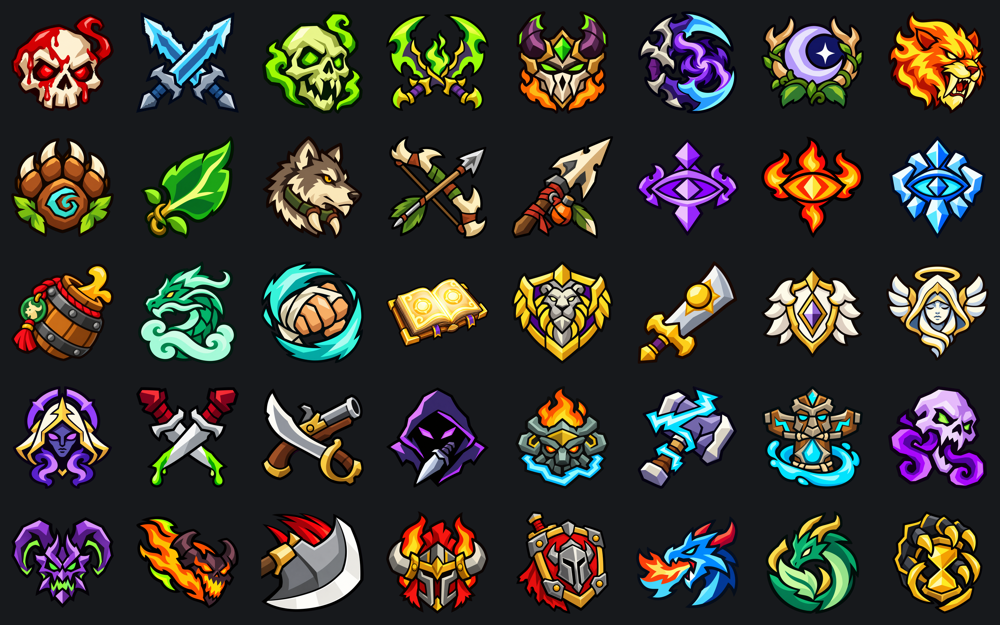

# Jiberish Fabled Icons

Custom class, race, and specialization icons for World of Warcraft.

- Open **/ji** or **/jiberishicons** to choose your icons and settings.
- Supports Blizzard, ElvUI, Shadowed Unit Frames, EllesmereUI, Details!, and chat. Available options vary by integration.
- Includes movable portraits and optional Player/Target cast rings.

## Installation

- Extract the **JiberishIcons** folder into `Interface/AddOns`, then restart WoW.
- Replacing **ElvUI_JiberishIcons**? Follow the [upgrade guide](UPGRADING.md) to keep your profiles. Don't install both folders.

## Icon packs

- **Fabled Class:** illustrated icons for all 13 classes.
- **Fabled Specializations:** icons for all 40 specs, including Devourer.
- **Fabled Regalia:** class crests. [Preview](images/FabledRegaliaWebsiteDisplay.png)
- **Fabled Azeroth:** race crests. [Preview](images/FabledAzerothWebsiteDisplay.png)
- **Fabled Core** and **Fabled Myth:** alternate class artwork.

## Setup

- **Unit frames:** Open `/ji`, select your frame addon, enable an icon or portrait, and choose a pack. ElvUI portraits also need ElvUI's class portrait mode enabled.
- **Blizzard damage meter:** Enable it under `/ji` → **Damage Meters**. Keep **Show Spec Icon** checked in Blizzard Edit Mode. Turn on **Custom Icon Size** to choose 12–64 pixels; Bar Height must be at least as large as the icon size you want.
- **Ellesmere damage meters:** Enable the integration under `/ji` → **Damage Meters**. Keep Ellesmere's Icon Style set to something other than **None**.
- **Details!:** Choose a Fabled pack under **Options → Bars: General → Icons → Texture**.
- **Portraits:** Open `/ji` → **Portraits**, enable the ones you want, then use **Unlock and preview** to place them. Choose a frame shape or **None — icon only**.
- **Cast rings:** Enable under **Portraits → Player or Target → Cast ring** with a Circle or Thin circle frame.
- **Chat:** Choose class or race icons under `/ji` → **Chat**.

## ElvUI tags

- Find the full list under **Available Tags → Jiberish Fabled Icons**.
- Paste a tag into a unit frame's **Custom Text** field.
- Class: `[jiberish:class:fabledclass{32}]`
- Spec: `[jiberish:spec:fabledspecializations{32}]`
- Race: `[jiberish:race:fabledazeroth{32}]`
- Change `32` to set the size. Add `:reverse` before `{32}` to mirror the icon.

## Spec icons

- Other players' spec icons depend on information WoW makes available. Unknown specs may use a class icon or stay hidden.
- Classic and Forever use your main talent tree. On Forever, group icons may need a completed fight and time outside combat to update.

## Links and credits

- [Discord support](https://discord.gg/mJKdmm9KGr) · [The Igloo / JiberishUI](https://theigloo.io/) · [Changelog](changelog.md)
- Thanks to **Blinkii**, **Repooc**, **Eltreum**, and **Trenchy**. Full credits are in the addon's Information and Style Packs tabs.
- Class and race crests are inspired by Blizzard Entertainment's artwork.
- Contributing? See [DEVELOPMENT.md](DEVELOPMENT.md).
