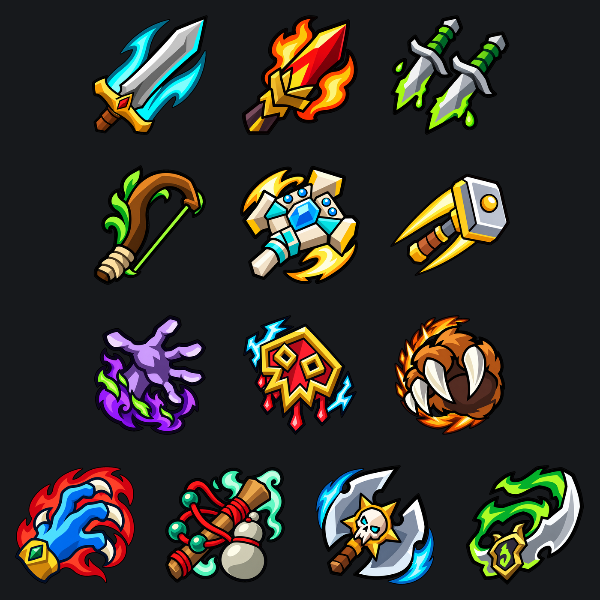
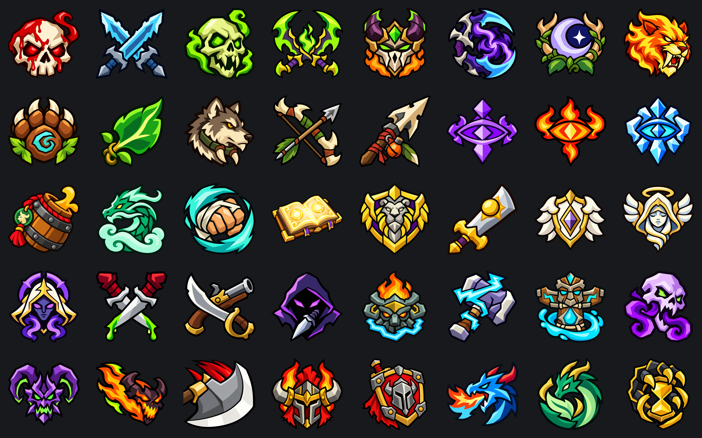

# Jiberish Fabled Icons

Custom class, race, and specialization icons for World of Warcraft.

- Open **/ji** or **/jiberishicons** for native WoW/ElvUI settings with Jiberish gradient headings and original settings icons.
- Supports Blizzard, ElvUI, Shadowed Unit Frames, EllesmereUI, Details!, and chat. Available options vary by integration.
- Includes movable portraits and optional Player/Target cast rings.
- Includes a movable crosshair with an optional global cooldown outline.
- Bushido and Overwatch themes style existing ElvUI and EllesmereUI health frames.
- Generated UI textures use lossless compression: full-resolution smooth edges and all customization options are retained.
- Optional 3D portraits live under Portraits, with shield, circle, diamond and square frames and independent per-unit placement.

## Installation

- Extract the **JiberishIcons** folder into `Interface/AddOns`, then restart WoW.
- Replacing **ElvUI_JiberishIcons**? Follow the [upgrade guide](UPGRADING.md) to keep your profiles. Don't install both folders.

## Icon packs

- **Fabled Class:** illustrated icons for all 13 classes.
- **Fabled Specializations:** icons for all 40 specs, including Devourer.
- **Fabled Regalia:** class crests. [Preview](images/FabledRegaliaWebsiteDisplay.png)
- **Fabled Azeroth:** race crests. [Preview](images/FabledAzerothWebsiteDisplay.png)
- **Fabled Core** and **Fabled Myth:** alternate class artwork.

## Setup

With ElvUI enabled, `/ji` opens **ElvUI → Jiberish Fabled Icons**. Settings use ElvUI's own fonts, controls, borders, search and window sizing. Without ElvUI, `/ji` opens the standard WoW/Ace3 options window. **JiberishIcons** groups Styles, ElvUI, Blizzard, Meters, Chat and other icon integrations. **Jiberish Plus** groups Frames, Portraits and Crosshair; **Profiles** and **Help** are shared tabs. Compact sidebars use bold, rounded settings glyphs and short white labels. Selected sections and tabs get brighter two-color gradients; inactive labels stay white. The title and ElvUI sidebar label pair blue–purple **JIBERISH** with pink–orange **FABLED ICONS**, with the active profile beneath the title. The separate dashboard has been removed.

- **Unit-frame icons:** Open `/ji`, open **JiberishIcons** and select your frame addon’s icon section, enable an icon or portrait, and choose a pack. ElvUI portraits also need ElvUI's class portrait mode enabled.
- **Blizzard damage meter:** Enable it under `/ji` → **JiberishIcons → Meters**. Keep **Show Spec Icon** checked in Blizzard Edit Mode. Turn on **Custom Icon Size** to choose 12–64 pixels; Bar Height must be at least as large as the icon size you want.
- **Ellesmere damage meters:** Enable the integration under `/ji` → **JiberishIcons → Meters**. Keep Ellesmere's Icon Style set to something other than **None**.
- **Details!:** Choose a Fabled pack under **Options → Bars: General → Icons → Texture**.
- **Portraits:** Open `/ji` → **Jiberish Plus → Portraits**, enable the ones you want, then use **Unlock and preview** to place them. Choose a frame shape or **None — icon only**.
- **Cast rings:** Enable under **Portraits → Player or Target → Cast ring** with a Circle or Thin circle frame.
- **Crosshair:** Open `/ji` → **Jiberish Plus → Crosshair**, enable it, and choose **During combat** or **Always**. Use **Unlock and preview** to drag it over your character, then lock it. Choose a solid or split **+ / X**, thin or bold lines, size, color and opacity. This is a fixed screen marker; reposition it if you change your camera view.
- **GCD outline:** Under **Crosshair → Global cooldown (GCD)**, enable a circle, diamond, square or triangle. The empty outline fills during the global cooldown and resets when it ends. Set its size, weight, fill color and empty outline color independently. Preview loops a sample fill while unlocked.
- **Copy and reverse layouts:** Open **Jiberish Plus → Frames → ElvUI / EllesmereUI → Target** (or another individual frame). Under **Copy an individual frame layout**, choose **Copy from: Player**, optionally enable **Reverse when copying**, then click **Copy Player to Target**. Copies theme, end-cap artwork, unit icons, portrait size, model fit, colors and relative placement. **Reverse this layout** mirrors an existing setup. Player, target, focus, pet, target of target and focus target are supported; party, raid and boss stay independent. The destination frame stays in its current screen position. Enable **Also copy ElvUI width / height** to match native dimensions too. A screen-placed portrait is converted to a unit-frame attachment while the source frame is visible.
- **Share profiles:** Open **Profiles → Export / import**, click **Generate export string**, and copy the entire string. The recipient pastes it, enters a profile name and chooses **Import as new profile**. Includes all current JiberishIcons profile settings and custom-pack definitions; existing profiles are preserved. For a complete matching UI, share ElvUI/EllesmereUI and Eltruism profiles separately, along with custom image files. Conflicting custom-pack names are reported instead of overwriting another profile’s artwork definitions.
- **3D portraits:** Open `/ji` → **Jiberish Plus → Portraits** → the unit → **Portrait content: 3D character portrait**. Choose **Overwatch shield**, **Circle**, **Diamond**, **Square** or no border. The 3D model sits in front of the upper rim and behind the lower lip. Adjust model width, height, X/Y, zoom, camera distance/pan, facing and border thickness under **3D model and frame**. **Reset character fit** restores the lower shoulder fit and headroom. Race, hairstyle and helmet may need additional fit adjustments in game.
- **Portrait placement:** Player, target, focus and other portrait units each have their own size, colors, placement and model fit. Choose **Attach to: ElvUI unit frame**, then **Portrait side: Left / Right**, or use screen placement and Unlock and preview. Existing enabled HUD portraits migrate here unless a Portraits entry is already enabled. The separate Overwatch HUD, center dial and action-bar styling have been removed.
- **Overwatch health cells:** Open **Jiberish Plus → Frames** → **ElvUI Unit Frames / EllesmereUI Unit Frames** → the unit category → **Overwatch**. Choose 5, 10 or 20 cells (20%, 10% or 5% each), six spacing levels, angled/rounded shapes, reversed slant, optional outlines, thickness and opacity. ElvUI continues to control size, position, health information, text and fonts; Eltruism retains colors and gradients. The native fill remains continuous.
- **GCD placement:** Under **Crosshair → Global cooldown (GCD)**, use **GCD horizontal offset / GCD vertical offset** to move the indicator relative to the crosshair. Zero centers it; moving the crosshair moves both together. Classic beta uses its own GCD reference spell; live timing falls back to timestamps if duration objects are unavailable.
- **Bushido frames:** Open `/ji` → **Jiberish Plus → Frames** → **ElvUI Unit Frames** or **EllesmereUI Unit Frames**, select a category, then choose **Bushido**. Adjust the silhouette, optional health divisions and Bushido end cap there. Keep using ElvUI/EllesmereUI for frame size, position, auras, fonts, textures and health colors, and Eltruism for your ElvUI gradients. Choose **Native** to restore that category or **Restore all** for the host. EllesmereUI individual frames require its normal frame style, rather than its Blizzard/Classic art kits. Theme changes wait until combat ends.
- **Chat:** Choose class or race icons under `/ji` → **JiberishIcons → Chat**.

## ElvUI tags

- Find the full list under **Available Tags → Jiberish Fabled Icons**.
- Paste a tag into a unit frame's **Custom Text** field.
- Class: `[jiberish:class:fabledclass{32}]`
- Spec: `[jiberish:spec:fabledspecializations{32}]`
- Race: `[jiberish:race:fabledazeroth{32}]`
- Change `32` to set the size. Add `:reverse` before `{32}` to mirror the icon.

## Spec icons

- Other players' spec icons depend on information WoW makes available. Unknown specs may use a class icon or stay hidden.
- Classic and Forever use your main talent tree. On Forever, group icons may need a completed fight and time outside combat to update.

## Links and credits

- [Discord support](https://discord.gg/mJKdmm9KGr) · [The Igloo / JiberishUI](https://theigloo.io/) · [Changelog](changelog.md)
- Thanks to **Blinkii**, **Repooc**, **Eltreum**, and **Trenchy**. Full credits are in the addon's Information and Style Packs tabs.
- Class and race crests are inspired by Blizzard Entertainment's artwork.
- Contributing? See [DEVELOPMENT.md](DEVELOPMENT.md).
